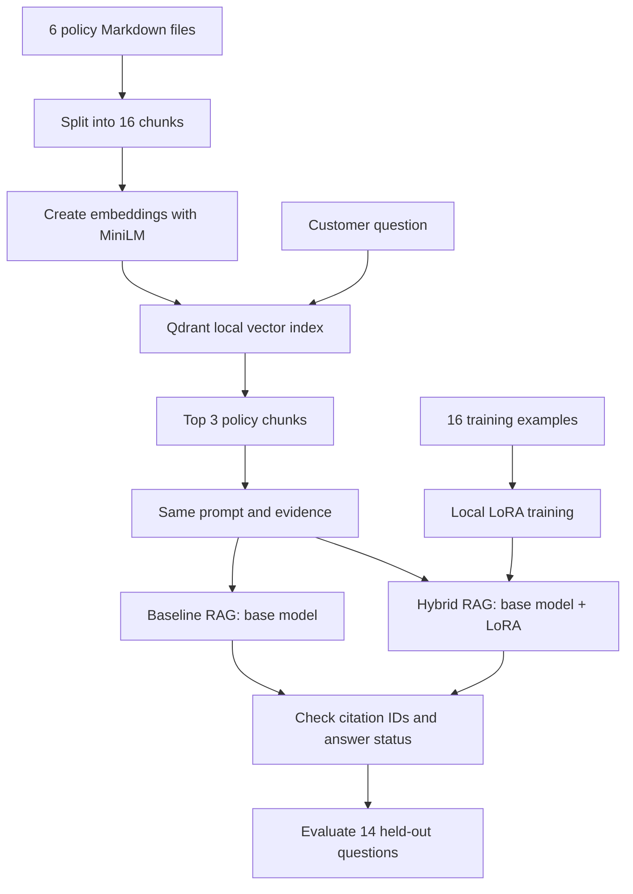

# Northstar Support Assistant — RAG + LoRA

A small, local AI project that combines **Retrieval-Augmented Generation (RAG)** and **LoRA fine-tuning**.

The assistant answers customer-support questions about refunds, subscriptions, shipping, account security, and technical incidents. It uses approved policy documents as its information source.

**Main question:** Does a small fine-tuned model give better support answers than a normal RAG system?

**Result:** LoRA helped the model follow the requested answer format, but it did **not** solve all accuracy and safety problems. Our decision is **REVISE**, not production deployment.

## 1. The idea in simple words

- **RAG** finds useful information in our current policy documents.
- **LoRA** trains a small adapter to help the model write short answers and follow our instructions.
- **Evaluation** checks whether the adapter really improves answers on questions not used for training.

We compare two systems. Everything is the same except the LoRA adapter:

| System | How it works |
|---|---|
| **Baseline RAG** | Search the policy documents, then ask the unchanged base model to answer. |
| **Hybrid RAG + LoRA** | Search the same documents and use the same prompt, but answer with the trained adapter enabled. |

## 2. Architecture



**Why this design?** Policies may change, so we keep them in RAG instead of trying to memorize them in the model. LoRA is used mainly to improve how the model responds.

## 3. Tools we used

| Tool | Purpose |
|---|---|
| Python + `uv` | Run the project and manage dependencies |
| Sentence Transformers: `all-MiniLM-L6-v2` | Turn text into embeddings |
| Qdrant (local mode) | Store vectors and find relevant policy chunks |
| `HuggingFaceTB/SmolLM2-135M-Instruct` | Small language model |
| PyTorch + Hugging Face PEFT | Train the LoRA adapter |
| Apple MPS | Run training and inference on the Mac GPU |
| `pytest` | Check the implementation |

The project runs locally. **No paid cloud service or hosted LLM API is required.** The models are downloaded from Hugging Face on first use.

## 4. What we built, step by step

### Step 1 — Check the data

**File:** `src/validate_data.py`

We checked three separate types of data:

- **6 policy files** in `data/knowledge_base/` — the approved information.
- **16 training examples** in `data/training/instruction_examples.jsonl` — examples for LoRA.
- **14 evaluation questions** in `data/evaluation/cases.json` — 10 answerable and 4 that should be declined.

We checked required fields, source IDs, duplicate IDs, and overlap between training and evaluation questions.

**Result:** Data validation passed.

### Step 2 — Build the RAG retriever

**File:** `src/retrieval.py`

1. Read the Markdown policy files.
2. Split paragraphs into **16 text chunks**.
3. Keep the source ID, filename, title, chunk position, and original text.
4. Create embeddings with MiniLM.
5. Store the vectors in a local Qdrant index.
6. For each question, retrieve up to **3 chunks**, using a minimum cosine score of **0.30**.

Example question: *“How long does standard shipping take?”*

The retriever finds the shipping policy, which says standard shipping usually takes **three to five business days**.

### Step 3 — Test retrieval

**File:** `src/evaluate_retrieval.py`

On the 10 answerable evaluation questions:

- **Recall@3: 100%** — all expected sources were found within the retrieved results.
- **MRR@3: 1.000** — an expected source was ranked first for every answerable question.

But retrieval alone made the correct answer/abstain decision in only **12 of 14** cases.

**Important lesson:** A document can be related to a question without containing the answer. Questions about bank chargebacks and shipping compensation received relevant search hits, but the policies did not provide enough information to answer them.

### Step 4 — Train a real LoRA adapter

**File:** `src/training.py`

We trained an adapter locally on the 16 support examples, using the base model **SmolLM2-135M-Instruct**.

| Training setting | Value |
|---|---|
| Device | Apple MPS |
| Epochs | 8 |
| Learning rate | 0.0002 |
| Max sequence length | 256 |
| Batch size | 1 |
| LoRA rank / alpha / dropout | 8 / 16 / 0.05 |
| LoRA target modules | `q_proj`, `v_proj` |
| Trainable parameters | 460,800 of 134,975,808 (**0.34%**) |

Training loss fell from **1.7444** (epoch 1) to **0.6994** (epoch 8).

The adapter is saved in `artifacts/support-lora-adapter/`. We save the adapter separately from the full base model.

**Important lesson:** Lower training loss means the model learned the training examples better. It does **not** prove that its new answers are correct.

### Step 5 — Compare the two answer paths

**File:** `src/generation.py`

We use **the same retrieved passages, prompt, model, and generation settings** for both paths. The baseline runs with the adapter disabled; the hybrid runs with it enabled.

We then check whether the answer:

- includes a citation such as `[shipping]`;
- uses only source IDs that the retriever actually found; or
- abstains because there is no usable evidence.

An answer without a required citation is **rejected**. A rejected answer is not the same as a correct abstention.

Example: For the shipping question, the baseline gave relevant text but forgot the citation. The hybrid added `[shipping]` and passed the citation-ID check.

**Limitation:** A valid citation ID does not prove that every sentence in the answer is true.

### Step 6 — Evaluate all 14 questions

**Files:** `src/evaluate_generation.py` and `src/build_evaluation_report.py`

We evaluated the baseline and hybrid with the same 14 held-out questions and the same rules.

| Metric | Baseline RAG | Hybrid RAG + LoRA |
|---|---:|---:|
| Answer/abstain decision accuracy | 21.4% | **64.3%** |
| Required-term coverage (accepted answers) | 10.0% | **50.0%** |
| Citation-faithfulness **proxy** | 10.0% | **40.0%** |
| Response-style **proxy** | 0.0% | **70.0%** |
| Correct abstentions for unsupported questions | 2 / 4 | **2 / 4** |
| Average generation time per question | 0.63 s | 0.64 s |

The hybrid improved the measured decision accuracy by **42.9 percentage points**. Most of the visible benefit came from following the required answer and citation format.

**Read these numbers carefully:** This is a small 14-case experiment. The proxy metrics use simple rules and do not fully test factual correctness. The timings measure generation only, not model startup, retrieval, or training.

### Step 7 — Write the final report and run tests

The detailed report is in **[`reports/evaluation_report.md`](reports/evaluation_report.md)**. It includes configuration, the real model outputs, per-question results, failure analysis, and our recommendation.

Our last full local test run passed: **63 tests passed**. This total includes tests from the supplied reference-solution folder as well as our own tests.

## 5. What did not work perfectly?

**Problem 1 — Missing account-recovery steps.** For a lost authenticator, the hybrid used a valid `[account-security]` citation but missed key policy steps, including the registered email and secure upload portal. A correct-looking citation was not enough.

**Problem 2 — Answering questions without enough evidence.** Both systems correctly abstained on clearly unrelated questions. But the hybrid also answered questions about bank chargebacks and shipping compensation, although the available policies did not answer them.

**Problem 3 — The score threshold is not a safety check.** The threshold of `0.30` finds relevant text, but cannot always tell if that text is sufficient. Raising the threshold alone could also reject valid questions.

## 6. Our decision

### REVISE — useful experiment, not ready for production

**What worked:** Local LoRA training succeeded, the adapter improved citation and style behavior, and the shared RAG pipeline retrieved the expected sources for all answerable evaluation cases.

**What still needs work:** The system must check whether the evidence truly supports the answer, not just whether a source was retrieved and cited.

**Next improvements:**

1. Add an **evidence-sufficiency check** before the model answers.
2. Compare against a stronger baseline with automatic citation formatting.
3. Test with more new questions, especially questions close to a policy topic but not answered by the policy.
4. Use a separate validation set and more training runs to check overfitting.

The goal is not only to make answers look better. The goal is to make them **correct, complete, and safe**.

## 7. How to run the project

Start in the repository root. The project uses Python **3.13.17+** and `uv` **0.13.5+**.

```bash
# Install dependencies
uv sync

# Create local settings
cp .env.example .env

# 1. Validate the input data
uv run python src/validate_data.py

# 2. Build the local vector index and test retrieval
uv run python src/retrieval.py

# 3. Evaluate the retriever
uv run python src/evaluate_retrieval.py

# 4. Train the LoRA adapter (required before hybrid inference)
uv run python src/training.py

# 5. Compare example answers
uv run python src/generation.py

# 6. Run the held-out benchmark
uv run python src/evaluate_generation.py

# 7. Generate the Markdown report from benchmark results
uv run python src/build_evaluation_report.py

# 8. Run all tests
uv run pytest -q
```

> The first runs download public models. The Qdrant index is rebuilt by the scripts. `reports/evaluation_results.json` is generated locally and is used to build the Markdown report. The trained adapter and generated evaluation traces are not meant to be committed to Git.

## 8. Project files

```text
mle-finetuning-rag-project/
├── data/
│   ├── knowledge_base/           # Six approved Markdown policies
│   ├── training/                 # 16 LoRA training examples
│   └── evaluation/               # 14 held-out questions
├── src/
│   ├── validate_data.py         # Check the datasets
│   ├── retrieval.py             # Chunk, embed, index, and search
│   ├── evaluate_retrieval.py    # Test retrieval quality
│   ├── training.py              # Train the local LoRA adapter
│   ├── generation.py            # Compare sample answers
│   ├── evaluate_generation.py   # Run the full comparison
│   └── build_evaluation_report.py # Create the final report
├── tests/                       # Our retrieval and report tests
├── reports/
│   └── evaluation_report.md     # Results and recommendation
├── artifacts/                   # Local adapter files (ignored by Git)
├── .env.example                 # Local settings template
├── pyproject.toml
└── README.md
```

The repository also contains the supplied `solution/` reference implementation and its tests. Our implementation lives in `src/`.

## 9. Short presentation summary

> **What did I build?** A local customer-support assistant using RAG and LoRA.
>
> **Why?** RAG gives the model current policy information. LoRA helps the model follow the requested response style.
>
> **How?** I loaded six policy documents, created embeddings, stored them in Qdrant, and trained a small LoRA adapter using 16 examples. Then I compared the base model and the adapted model using the same 14 test questions.
>
> **What did I find?** Decision accuracy increased from 21.4% to 64.3%, mainly because the adapter followed the citation and formatting rules better. But both systems still had problems knowing when they should not answer.
>
> **My conclusion:** Fine-tuning can improve behavior, but it does not replace good retrieval, evidence checks, and evaluation. I would improve the safety checks before using this system in real customer support.
