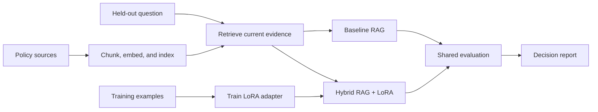

# Fine-Tuning + RAG Project

Please **use this repository as a template** for your hybrid language-model
project. Build an assistant for the fictional Northstar customer-support team
that retrieves current policy evidence and uses a locally trained
[LoRA](https://arxiv.org/abs/2106.09685) adapter to produce concise,
evidence-aware replies.

This assignment combines the earlier work on
[retrieval-augmented generation (RAG)](https://arxiv.org/abs/2005.11401),
[vector search](https://qdrant.tech/documentation/concepts/search/), and
[parameter-efficient fine-tuning](https://huggingface.co/docs/peft/index).
It follows the earlier strategy lesson by turning the selected hybrid pattern
into an assessed implementation with a real local fine-tuning run and a
measured comparison against a baseline RAG system.

## Learning Path

1. Read the [project brief](project-description.md) and inspect the supplied
   policy, training, and evaluation data.
2. Build a retriever that preserves source IDs and applies a defensible
   evidence threshold.
3. Fine-tune the supplied small model with LoRA on the training examples.
4. Implement both baseline RAG and hybrid RAG plus LoRA answer paths.
5. Benchmark the systems on the same held-out cases and write an evaluation
   report.
6. Inspect the separate [reference solution](solution/README.md) only after
   attempting the project.



## Project Materials

- [project-description.md](project-description.md): scenario, requirements,
  milestones, deliverables, and acceptance checklist.
- [data/knowledge_base/](data/knowledge_base/): approved policy sources for
  retrieval.
- [data/training/instruction_examples.jsonl](data/training/instruction_examples.jsonl):
  supervised examples for the adapter.
- [data/evaluation/cases.json](data/evaluation/cases.json): held-out benchmark
  cases used for retrieval and answer evaluation.
- [solution/README.md](solution/README.md): runnable reference implementation.

## Environment

The supplied solution uses
[Hugging Face Transformers](https://huggingface.co/docs/transformers/index),
[PEFT](https://huggingface.co/docs/peft/index), and
[PyTorch](https://pytorch.org/docs/stable/index.html) for local LoRA training.
It uses
[Sentence Transformers](https://www.sbert.net/) for embeddings and
[Qdrant local mode](https://qdrant.tech/documentation/quickstart/) as the
vector database. The default
[SmolLM2 135M Instruct model](https://huggingface.co/HuggingFaceTB/SmolLM2-135M-Instruct)
is small enough for the reference workflow while still providing an
instruction-oriented chat template.

### macOS

```bash
pyenv local 3.11.3
python -m venv .venv
source .venv/bin/activate
python -m pip install --upgrade pip
python -m pip install -r requirements.txt
cp .env.example .env
```

### Windows PowerShell

```powershell
pyenv local 3.11.3
python -m venv .venv
.venv\Scripts\Activate.ps1
python -m pip install --upgrade pip
python -m pip install -r requirements.txt
Copy-Item .env.example .env
```

### Windows Git Bash

```bash
pyenv local 3.11.3
python -m venv .venv
source .venv/Scripts/activate
python -m pip install --upgrade pip
python -m pip install -r requirements.txt
cp .env.example .env
```

The first training and evaluation runs download the configured public models
from the [Hugging Face Hub](https://huggingface.co/docs/hub/index). Generated
adapter weights, model caches, vector storage, and machine-readable evaluation
traces must remain outside version control.

## Required Deliverables

Your repository must include:

- reproducible policy ingestion, chunking, embedding, indexing, and retrieval;
- a real local LoRA training command and saved adapter configuration;
- baseline RAG and hybrid RAG plus LoRA answer paths using the same retriever;
- citation validation and abstention when evidence is unsupported;
- evaluation code that reports retrieval quality separately from answer
  relevance, faithfulness, style compliance, and decision accuracy;
- `reports/evaluation_report.md` with a per-case comparison, failure analysis,
  threshold decision, and prioritized next experiments;
- tests covering data contracts, retrieval metadata, unsupported questions,
  citations, and report generation; and
- a concise README explaining architecture, commands, and conclusions.

## Learning Objectives

By completing this project, you should be able to:

- Build a hybrid RAG plus fine-tuned system using a real local LoRA adapter.
- Benchmark the hybrid system against a baseline RAG pipeline on the same
  held-out cases.
- Separate retrieval quality from answer relevance, faithfulness, response
  style, and abstention behavior.
- Decide whether adaptation adds enough value to justify its training,
  deployment, and maintenance cost.

## Useful References

- Lewis et al.,
  [Retrieval-Augmented Generation for Knowledge-Intensive NLP Tasks](https://arxiv.org/abs/2005.11401).
- Hu et al.,
  [LoRA: Low-Rank Adaptation of Large Language Models](https://arxiv.org/abs/2106.09685).
- [Hugging Face PEFT LoRA guide](https://huggingface.co/docs/peft/developer_guides/lora).
- [Hugging Face causal language-model training](https://huggingface.co/docs/transformers/tasks/language_modeling).
- [Sentence Transformers semantic search](https://www.sbert.net/examples/sentence_transformer/applications/semantic-search/README.html).
- [Qdrant local quickstart](https://qdrant.tech/documentation/quickstart/).
- [Ragas metrics](https://docs.ragas.io/en/stable/concepts/metrics/available_metrics/)
  for extending answer evaluation.
