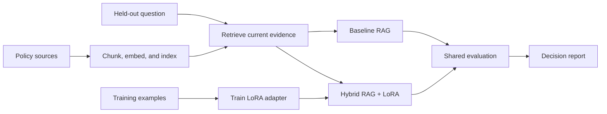

# Fine-Tuning + RAG Project

Please **use this repository as a template** for your hybrid language-model
project. Build an assistant for the fictional Northstar customer-support team
that retrieves current policy evidence and uses a locally trained
[LoRA](https://arxiv.org/abs/2106.09685) adapter to produce concise,
evidence-aware replies.

This assignment combines the earlier work on
[retrieval-augmented generation (RAG)](https://arxiv.org/abs/2005.11401),
[vector search](https://qdrant.tech/documentation/concepts/search/), and
[parameter-efficient fine-tuning](https://huggingface.co/docs/peft/index).
It follows the earlier strategy lesson by turning the selected hybrid pattern
into an assessed implementation with a real local fine-tuning run and a
measured comparison against a baseline RAG system.

## Learning Objectives

By completing this project, you should be able to:

- Build a hybrid RAG plus fine-tuned system using a real local LoRA adapter.
- Benchmark the hybrid system against a baseline RAG pipeline on the same
  held-out cases.
- Separate retrieval quality from answer relevance, faithfulness, response
  style, and abstention behavior.
- Decide whether adaptation adds enough value to justify its training,
  deployment, and maintenance cost.

## Learning Path

| File / Folder | Description |
|---|---|
| [**Project Brief**](project-description.md) | Scenario, milestones, deliverables, and acceptance checklist. |
| [**Policy Sources**](data/knowledge_base/) | Build a retriever that preserves source IDs and applies an evidence threshold. |
| [**Training Examples**](data/training/instruction_examples.jsonl) | Train a local LoRA adapter, then compare baseline RAG and hybrid RAG plus LoRA. |
| [**Held-Out Cases**](data/evaluation/cases.json) | Benchmark both systems on the same questions and write a decision report. |



### Additional Folders and Files

| File / Folder | Description |
|---|---|
| [**data**](data/) | Approved policy sources, instruction examples, and held-out benchmark cases. |
| [**solution**](solution/README.md) | Runnable reference implementation and tests; inspect after attempting the project. |
| [**.env.example**](.env.example) | Local model and retrieval configuration template. |
| [**pyproject.toml**](pyproject.toml) | Project configuration and dependencies. |
| [**uv.lock**](uv.lock) | Dependency lock file. |

## Setup

Use [uv](https://docs.astral.sh/uv/getting-started/installation/) 0.13.5 or newer
and Python 3.13.17 or newer. Python 3.13.18 is recommended when available.

> [!NOTE]
> Throughout these steps, text in angle brackets like `<repo-name>` is a **placeholder**. Replace it, including the `< >` brackets, with your own value. For example, `cd <repo-name>` becomes `cd mle-finetuning-rag-project`.

### 1. Create the Repository from the Template

Click **Use this template** on GitHub.

When creating the repository:

- Set yourself as the **Owner**
- Choose a repository name
- Disable **Include all branches**
- Click **Create repository**

> [!IMPORTANT]
> If you are working in pairs or groups, only **one person** should complete this step.

---

### 2. Add Collaborators (Pairs/Groups Only)

If working with teammates:

1. Open the repository on GitHub
2. Go to **Settings → Collaborators**
3. Add your teammates as collaborators
4. Share the repository link with your team

Teammates should accept the invitation before continuing.

---

### 3. Clone the Repository

Copy the SSH URL from the **Code** button on GitHub, then run:

```bash
git clone <copied-ssh-url>
```

The copied SSH URL will look like `git@github.com:<your-username>/<repo-name>.git`.

---

### 4. Move into the Project Folder and Install Dependencies

The command below installs all dependencies and creates a virtual environment in `.venv/`.

```bash
cd <repo-name>
uv sync
```

The first training and evaluation runs download the configured public models from the [Hugging Face Hub](https://huggingface.co/docs/hub/index). The reference solution uses local Sentence Transformers embeddings, Qdrant local mode, and SmolLM2 with PEFT. The default base and embedding model revisions are pinned. Set `BASE_MODEL_REVISION` or `EMBEDDING_REVISION` explicitly when changing models. No hosted service or API key is required. Keep generated adapters, vector storage, and evaluation traces out of Git.

---

### 5. Set Up Environment Variables

Copy the default local model and retrieval settings:

```bash
cp .env.example .env
```

The reference solution runs locally without a hosted API key. Keep the default settings for your first run; `.env` lets you change them later.

> [!CAUTION]
> Never commit `.env`. It is git-ignored because environment files often hold secrets. Only `.env.example`, with placeholder or default values, belongs in the repository.

---

### 6. Open the Repository in VS Code

> [!NOTE]
> Make sure you open VS Code from the project root so it automatically detects the environment created by `uv sync`.

Launch VS Code in the project root folder:

```bash
code .
```

Select the Python interpreter in `.venv/` created by `uv sync`. Run the [reference solution commands](solution/README.md#run-the-reference-workflow) from the project root.

## Required Deliverables

Your repository must include:

- reproducible policy ingestion, chunking, embedding, indexing, and retrieval;
- a real local LoRA training command and saved adapter configuration;
- baseline RAG and hybrid RAG plus LoRA answer paths using the same retriever;
- citation validation and abstention when evidence is unsupported;
- evaluation code that reports retrieval quality separately from answer
  relevance, faithfulness, style compliance, and decision accuracy;
- `reports/evaluation_report.md` with a per-case comparison, failure analysis,
  threshold decision, and prioritized next experiments;
- tests covering data contracts, retrieval metadata, unsupported questions,
  citations, and report generation; and
- a concise README explaining architecture, commands, and conclusions.

## Useful References

- Lewis et al.,
  [Retrieval-Augmented Generation for Knowledge-Intensive NLP Tasks](https://arxiv.org/abs/2005.11401).
- Hu et al.,
  [LoRA: Low-Rank Adaptation of Large Language Models](https://arxiv.org/abs/2106.09685).
- [Hugging Face PEFT LoRA guide](https://huggingface.co/docs/peft/developer_guides/lora).
- [Hugging Face causal language-model training](https://huggingface.co/docs/transformers/tasks/language_modeling).
- [Sentence Transformers semantic search](https://www.sbert.net/examples/sentence_transformer/applications/semantic-search/README.html).
- [Qdrant local quickstart](https://qdrant.tech/documentation/quickstart/).
- [Ragas metrics](https://docs.ragas.io/en/stable/concepts/metrics/available_metrics/)
  for extending answer evaluation.
