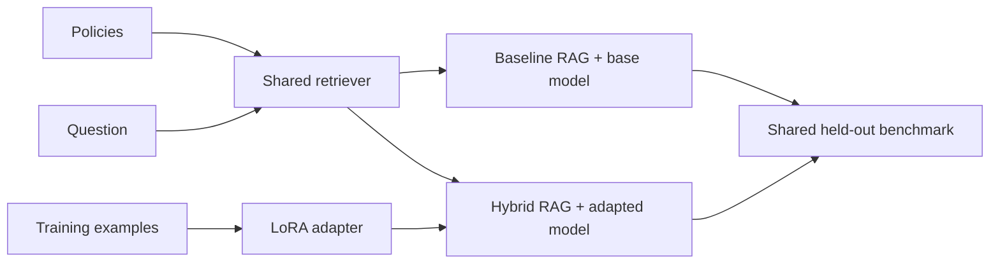

# Reference Solution

This folder contains a complete implementation of the Northstar Fine-Tuning +
RAG project. The solution keeps data validation, retrieval, adapter
training, generation, and evaluation as separate responsibilities so each
decision can be inspected or replaced.

The real project path uses:

- [Sentence Transformers](https://www.sbert.net/) for dense policy embeddings;
- [Qdrant local mode](https://qdrant.tech/documentation/quickstart/) for vector
  storage with source metadata;
- [Hugging Face Transformers](https://huggingface.co/docs/transformers/index)
  and [PyTorch](https://pytorch.org/docs/stable/index.html) for the local causal
  language model, using
  [SmolLM2 135M Instruct](https://huggingface.co/HuggingFaceTB/SmolLM2-135M-Instruct)
  by default;
- [Hugging Face PEFT](https://huggingface.co/docs/peft/index) for a real LoRA
  optimization run; and
- deterministic metric rubrics that keep retrieval, relevance, faithfulness,
  response style, decisions, and latency separate.

## Read The Solution In This Order

1. [datasets.py](hybrid_project/datasets.py) validates source IDs, training
   records, evaluation labels, and train/evaluation separation.
2. [documents.py](hybrid_project/documents.py) loads policies and creates
   citable chunks.
3. [embeddings.py](hybrid_project/embeddings.py),
   [store.py](hybrid_project/store.py), and
   [retrieval.py](hybrid_project/retrieval.py) implement the shared retriever.
4. [prompts.py](hybrid_project/prompts.py) defines one serialization format for
   training and inference.
5. [training.py](hybrid_project/training.py) selects architecture-appropriate
   LoRA projections, masks prompt tokens, runs optimization, and saves the
   adapter separately.
6. [generation.py](hybrid_project/generation.py) loads the unchanged base model
   or base model plus adapter.
7. [pipeline.py](hybrid_project/pipeline.py) enforces the same retrieval
   threshold and citation validation for both RAG systems.
8. [evaluation.py](hybrid_project/evaluation.py) runs the shared benchmark and
   writes the decision report.



## Folder Layout

```text
solution/
|-- hybrid_project/
|   |-- cli.py
|   |-- config.py
|   |-- datasets.py
|   |-- documents.py
|   |-- embeddings.py
|   |-- evaluation.py
|   |-- generation.py
|   |-- models.py
|   |-- pipeline.py
|   |-- prompts.py
|   |-- retrieval.py
|   |-- store.py
|   `-- training.py
|-- reports/
|   `-- reference_evaluation.md
|-- tests/
`-- README.md
```

Inputs and dependencies remain at the repository root so participants and the
reference implementation use the same data contracts.

## Create The Environment

Run these commands from the repository root.

### macOS

```bash
pyenv local 3.11.3
python -m venv .venv
source .venv/bin/activate
python -m pip install --upgrade pip
python -m pip install -r requirements.txt
cp .env.example .env
```

### Windows PowerShell

```powershell
pyenv local 3.11.3
python -m venv .venv
.venv\Scripts\Activate.ps1
python -m pip install --upgrade pip
python -m pip install -r requirements.txt
Copy-Item .env.example .env
```

### Windows Git Bash

```bash
pyenv local 3.11.3
python -m venv .venv
source .venv/Scripts/activate
python -m pip install --upgrade pip
python -m pip install -r requirements.txt
cp .env.example .env
```

## Run The Reference Workflow

### 1. Validate The Data

```bash
python -m solution.hybrid_project inspect-data
```

This confirms that training and held-out records reference real policy sources
and that evaluation questions were not copied into training.

### 2. Build The Shared Index

```bash
python -m solution.hybrid_project index
```

The command downloads the configured embedding model on first use, creates
paragraph-aware chunks, and indexes them in Qdrant local mode.

### 3. Train The LoRA Adapter

```bash
python -m solution.hybrid_project train
```

The command performs a real optimization loop and saves adapter weights plus
`training_summary.json` under `artifacts/support-lora-adapter/`. That directory
is ignored because participants regenerate it locally.

### 4. Compare One Question

```bash
python -m solution.hybrid_project ask \
  --system rag-base \
  "Can support change an address after the warehouse packed an order?"

python -m solution.hybrid_project ask \
  --system rag-lora \
  "Can support change an address after the warehouse packed an order?"
```

Both systems receive the same retrieved chunks. The second command changes only
the model by loading the adapter.

### 5. Generate The Evaluation Report

```bash
python -m solution.hybrid_project evaluate
```

This writes
[reference_evaluation.md](reports/reference_evaluation.md) and a regenerated
JSON trace. The report separates shared retrieval metrics from each system's
answer metrics.

### 6. Run Tests

```bash
python -m pytest solution/tests
```

Tests use explicitly labeled deterministic embedding and generation
substitutes. They validate contracts and behavior without downloading models;
they are not evidence that LoRA improves answer quality.

## Smoke Mode

The following command checks orchestration quickly:

```bash
python -m solution.hybrid_project --hash-smoke evaluate \
  --output solution/reports/smoke_evaluation.md
```

Smoke mode is for development only. The submitted decision report must come
from the real dense retriever and real base/adapter model paths.

## Implementation Decisions

### Why Share The Retriever?

Using one retriever, evidence threshold, prompt structure, and benchmark keeps
the comparison focused on the adapter. Different retrieval results would
confound the fine-tuning decision.

### Why Mask Prompt Tokens During Training?

The adapter loss is calculated on the target answer rather than rewarding the
model for reproducing context and question text. This keeps the small training
signal focused on response behavior.

### Why Validate Citations After Generation?

Prompt instructions do not guarantee compliant output. A generated answer is
accepted only when it cites at least one retrieved source and invents no source
ID.

### Why Include Base-Only Results?

Base-only results expose whether retrieval itself adds value. The required
project decision remains baseline RAG versus hybrid RAG plus LoRA.
